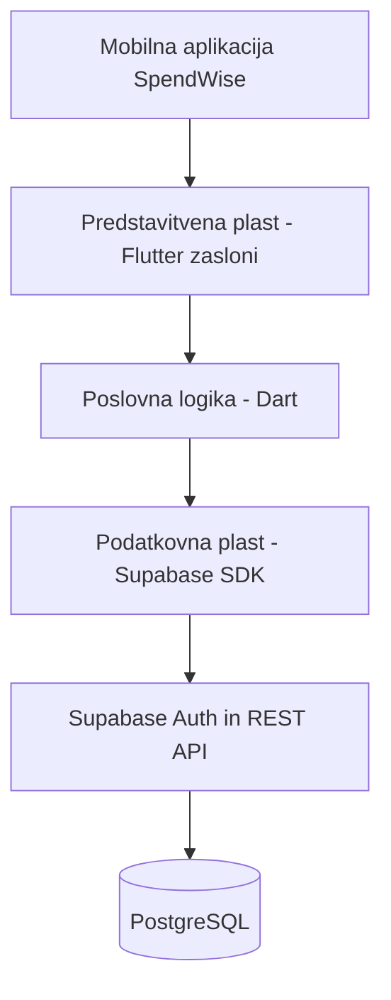

# SpendWise – Začetna arhitektura aplikacije

## 1. Arhitekturna zasnova

SpendWise bo mobilna aplikacija, razvita z ogrodjem
Flutter in programskim jezikom Dart.

Za avtentikacijo, spletne storitve in podatkovno bazo
bo uporabljena platforma Supabase.

Aplikacija bo razdeljena na tri logične plasti:

- Predstavitvena plast
- Plast poslovne logike
- Podatkovna plast

## 2. Arhitekturni diagram

## 3. Predstavitvena plast

Uporabniški vmesnik bo izdelan v Flutterju.

Predvideni zasloni:
- Prijava in registracija
- Začetni zaslon
- Transakcije
- Proračun
- Statistika
- Varčevalni cilji

Za navigacijo bo uporabljena spodnja navigacijska
vrstica s petimi glavnimi zavihki.

## 4. Poslovna logika

Ta plast bo odgovorna za:

- Preverjanje pravilnosti vnesenih podatkov.
- Izračun skupnih prihodkov in odhodkov.
- Izračun trenutnega finančnega stanja.
- Spremljanje mesečnih proračunov.
- Izračun napredka varčevalnih ciljev.
- Ugotavljanje preseženih omejitev porabe.

## 5. Podatkovna plast

Za komunikacijo s spletno storitvijo bo uporabljen
Supabase Flutter SDK.

Podatki bodo shranjeni v PostgreSQL.

Supabase Auth bo omogočal registracijo, prijavo
in upravljanje uporabniških sej.

Dostop do podatkov bo omejen z uporabo
Row Level Security (RLS).

## 6. Predvidena struktura izvorne kode

lib/
- main.dart
- screens/ – zasloni aplikacije
- models/ – podatkovni modeli
- services/ – komunikacija s Supabase
- widgets/ – ponovno uporabne komponente
- utils/ – pomožne funkcije in izračuni

## 7. Razvojna orodja

- Flutter in Dart
- Android Studio
- Supabase
- GitHub
- GitHub Actions
- Figma oziroma pripravljeni mockupi

## 8. Varnost

Uporabniški podatki bodo zaščiteni z avtentikacijo
in pravili RLS.

Gesla ne bodo shranjena neposredno v aplikaciji.

V GitHub repozitorij ne bodo vključeni zasebni
ključi ali druge skrivnosti.

## 9. Trenutno stanje

Flutter projekt je ustvarjen in začetna aplikacija
je bila uspešno zagnana.

Supabase povezava in poslovne funkcionalnosti
so načrtovane za naslednje faze razvoja.
