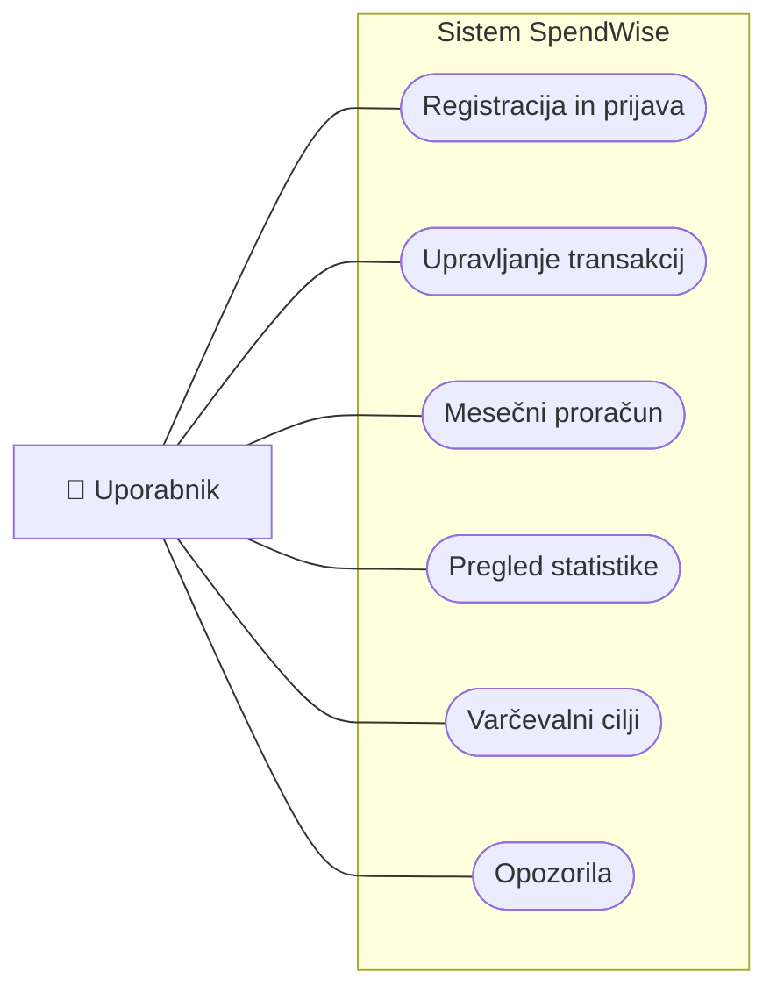

# SpendWise – Diagram primerov uporabe

Diagram prikazuje ključne funkcionalnosti mobilne aplikacije SpendWise.

## Opis

Uporabnik lahko:
- Ustvari račun in se prijavi.
- Dodaja, ureja in briše finančne transakcije.
- Nastavlja mesečne proračune.
- Pregleduje statistiko prihodkov in odhodkov.
- Upravlja varčevalne cilje.
- Prejema opozorila o porabi.
