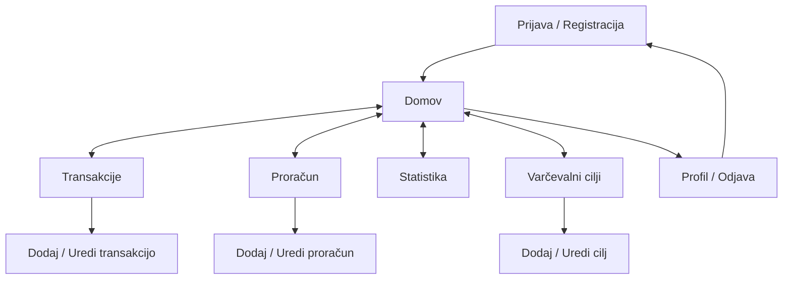

# SpendWise – Navigacija med zasloni

## Opis navigacije

Aplikacija SpendWise bo omogočala enostavno
navigacijo med glavnimi funkcionalnostmi.

Ob zagonu se neprijavljenemu uporabniku prikaže
prijavni zaslon. Po uspešni prijavi se odpre
začetni zaslon.

Glavni razdelki aplikacije:
- Domov
- Transakcije
- Proračun
- Statistika
- Varčevalni cilji

Med glavnimi razdelki bo uporabnik prehajal
s spodnjo navigacijsko vrstico.

## Diagram navigacije

## Glavni uporabniški tokovi

### Prijava
Uporabnik vnese e-poštni naslov in geslo.
Po uspešni prijavi se odpre začetni zaslon.

### Upravljanje transakcij
Uporabnik odpre razdelek Transakcije, kjer lahko
pregleduje, dodaja, ureja ali briše transakcije.

### Upravljanje proračunov
Uporabnik odpre razdelek Proračun, kjer lahko
nastavi mesečne omejitve porabe po kategorijah.

### Pregled statistike
Uporabnik odpre razdelek Statistika in pregleduje
grafične prikaze prihodkov ter odhodkov.

### Varčevalni cilji
Uporabnik odpre razdelek Varčevalni cilji, kjer
lahko dodaja cilje in spremlja napredek.

### Odjava
Uporabnik v profilu izbere odjavo, aplikacija
pa ga vrne na prijavni zaslon.

## Trenutno stanje

Navigacija je trenutno načrtovana in predstavljena
z diagramom ter mockupi. Implementirana bo v
naslednji fazi razvoja.
