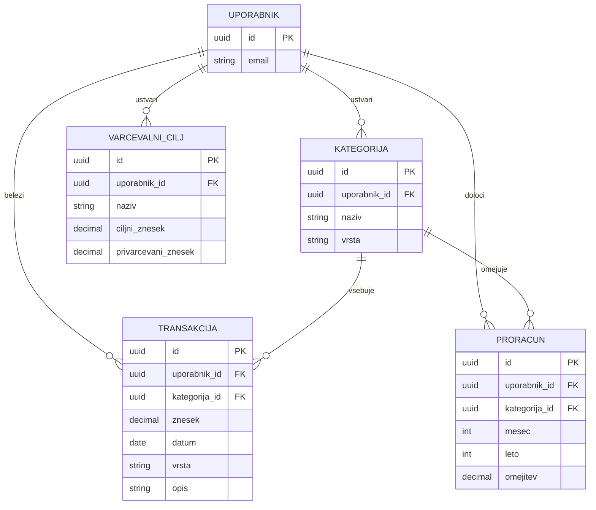

# SpendWise – Začetni podatkovni model

Podatkovni model aplikacije SpendWise temelji na relacijski
podatkovni bazi PostgreSQL, ki jo zagotavlja Supabase.

## ER diagram

## Opis tabel

### Uporabnik
Podatki uporabnika, povezanega s Supabase Auth.
Vsak uporabnik ima svoj enolični identifikator UUID.

### Kategorija
Kategorije, kot so Hrana, Prevoz, Bivanje in Plača.
Vrsta določa, ali gre za prihodke ali odhodke.

### Transakcija
Posamezen prihodek ali odhodek.
Vsebuje znesek, datum, kategorijo in opis.

### Proračun
Mesečna omejitev porabe za izbrano kategorijo.
Poraba se izračuna iz transakcij za izbrani mesec.

### Varčevalni cilj
Ciljni in trenutno privarčevani znesek.
Napredek se izračuna kot delež privarčevanega
zneska glede na ciljni znesek.

## Povezave in omejitve

- En uporabnik ima lahko več transakcij.
- En uporabnik ima lahko več kategorij.
- Ena kategorija lahko vsebuje več transakcij.
- Ena kategorija ima lahko več mesečnih proračunov.
- En uporabnik ima lahko več varčevalnih ciljev.
- Zneski transakcij in proračunov morajo biti pozitivni.
- Vrsta transakcije mora ustrezati vrsti kategorije.
- Za posamezno kategorijo je dovoljen največ en
  proračun za določen mesec in leto.
- Uporabnik lahko dostopa samo do svojih podatkov.

## Načrtovana implementacija

Podatkovna baza bo PostgreSQL v storitvi Supabase.
Prijava bo izvedena s Supabase Auth.
Za varnost podatkov bodo uporabljena pravila
Row Level Security (RLS).

Model je začetna zasnova in se lahko med razvojem
aplikacije dopolni.
